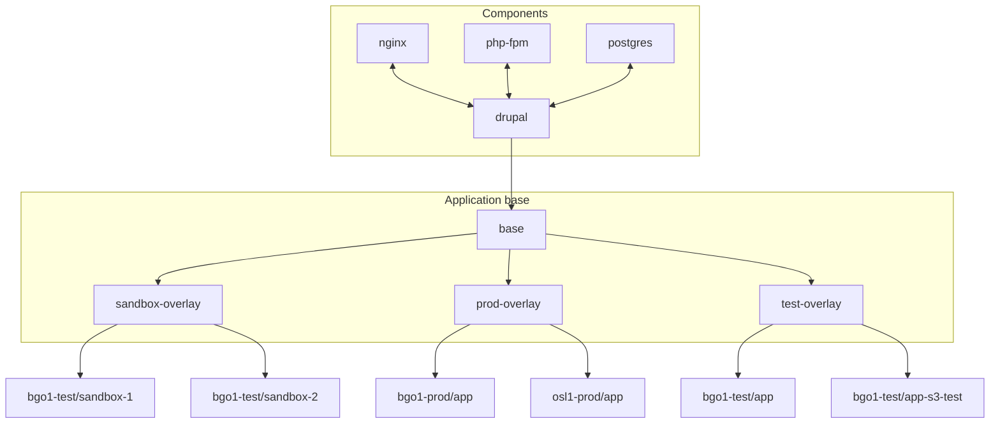

# RAIL adm-it-pub Gitops Repository

This repository encapsulates the kubernetes configuration for all services on RAIL that Publisering is responsible for.
This repository is automatically synced to RAIL through FluxCD, each directory syncs to a different cluster.

## Repository structure

Every directory should contain a README.md explaining in detail how that specific component, application base, etc
works. If one is missing, please help out by adding / updating :)

This repository follows combines some best practices for Flux setup and RAIL Gitops setup.

Read more about FluxCD setup
here: [https://fluxcd.io/flux/guides/repository-structure/](https://fluxcd.io/flux/guides/repository-structure/)

You can read more specifics on the GitOps setup for RAIL
here: [https://rail.uib.no/docs/gitops.html](https://rail.uib.no/docs/gitops.html)

```txt
.
├── components                   # Puzzle pieces that you can use to construct a base / bigger components
│   ├── nginx                    # Name of application base
│   │   ├── kustomization.md     # Kustomization to import for this component
│   │   └── README.md            # README that describes the component
│   └── drupal                   # Name of application base
│       ├── kustomization.md     # Kustomization to import for this component
│       └── README.md            # README that describes the component
├── docs                         # Any relevant docs for setup, operations, tips, etc
├── base                         # Base configuration for an app in all clusters
│   ├── profile                  # Configuration for profile, overlays app template
│   │   ├── base                 # Common config used in all environments
│   │   ├── production           # Prod specific manifests, overlays base
│   │   ├── test                 # Test specific manifests, overlays base
│   │   └── README.md            # README that explains the base
│   └── skeivtarkiv              # Configuration for skeivtarkiv goes in this dir
├── bgo1-test                    # Cluster specific configuration
│   ├── RAIL                     # Definition manifests for apps in this cluster
│   └── profile                  # Cluster specific configuration, overlays test
├── bgo1-prod                    # Another production cluster, similar setup to bgo1-test
│   ├── RAIL                     # Definition manifests for apps in this cluster
│   └── profile                  # Cluster specific configuration, overlays production
├── scripts                      # Useful scripts, may be used as configmaps to be used in jobs
│   └── upload-s3                # Example of a script
│       ├── upload-s3.sh         # Relevant script
│       └── README.md            # README that describes the script and how / when to use it
└── README.md
```

A better illustration of how overlays tie together the application. The following example application mirrors how
 the profile is constructed and shows how six different environments share configuration.

## Example PHP application



The idea is to simplify creating the different environments, especially when the application becomes larger and more
complex. So we have split applications into four pieces:

- Components - which are building blocks used to construct an application. E.g drupal11, nginx, php-fpm,
  postgres [E.g components/php-fpm]
- Base - Ties together components to build the application and contains as much of the generics of the application as
  possible. E.g cron jobs, custom deployments, etc [E.g base/profile/base]
- Environments - Overlays the base to add environment specific logic. E.g database restores for test environments,
  etc [E.g production, test, sandbox]
- Clusters - The binding between an environment and a concrete namespace in a cluster. Also contains cluster specific
  secrets if relevant. [E.g bgo1-test/profile, bgo1-prod/profile.]

Where different configuration goes is not strictly defined, but as a rule of thumb start as close the edge as possible,
as you test and validate it works you can promote it closer to the base.

Thought example:

- start in bgo1-test/profile
- if relevant for all test environments, promote to test
- if relevant for all profile environments, promote to base
- if relevant for all drupal11 applications, promote to drupal11 component
- if relevant for all php-fpm applications, promote to php-fpm component

## The setup feels a bit overcomplicated

This might look very overwhelming, but the full setup is meant more for lager applications like profile and W4, where we
have many components and many environments all having minor differences and we want to prevent a hundreds of copy-pasted
manifests everywhere which would be very hard to maintain. This is also a recipe, not a rule. As we worked on and grew
profile, we naturally fell into this structure and feel it as worked well in that use-case.

## Where do I even begin creating a new application?

Not all applications require a base from the beginning. Usually we would recommend working from a specific environment
and rather promoting configuration to a base as you see it is generic. It can be hard to know what is generic config and
what is environment specific up front. So for a new application, it might be worth just creating an instance inside e.g
`bgo1-test/app` and start from there. As your app grows and you see need to re-use between clusters you can create a
`base/app` and put configuration there. You might publish a static application where environment specific overlays are
not relevant, in that case a simple base is probably enough.

Design for your use-case, we have just create a recipe, it might not work for all applications.

TODO: Templates?

## How to change configuration in only one environment

In cases that you want to change an app template and want to validate it before updating all instances, you can create a
patch to the manifest that changes your specific settings in the environment you are interested in.
Once you have validated that everything works properly, you can update the main manifest if necessary.

> **Tips:** Use `flux-drift.sh` and `flux-template.sh` to validate that the different environments get the expected
> diffs / manifests. See how they work in docs/tools.