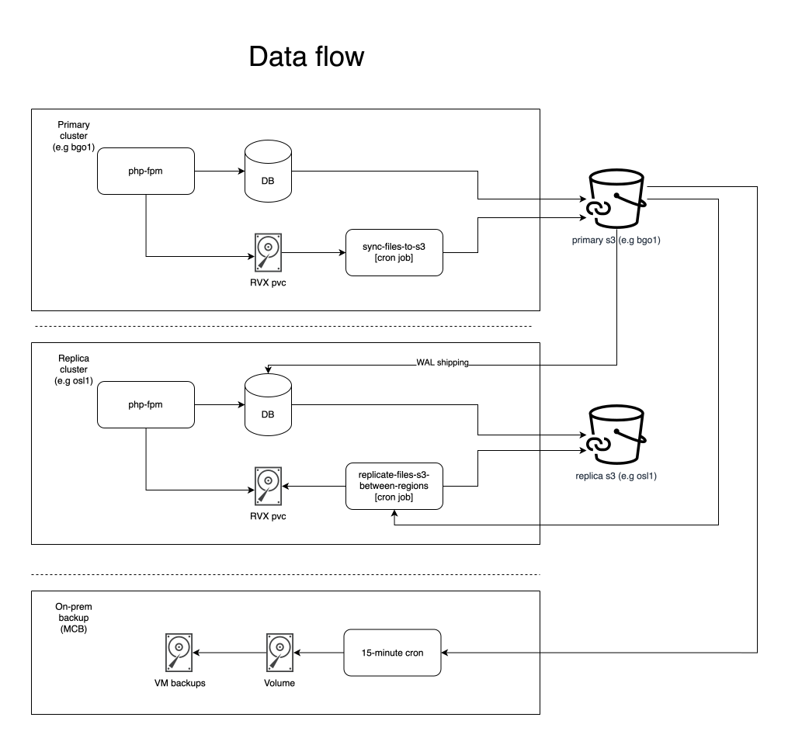

# W4

## Overview

W4 is UiB's most prominent website and front to the internet.

## Architecture

Application base: `/base/w4`

Components:

| Component      | Description                           |
| -------------- | ------------------------------------- |
| Postgres 17    | PostgreSQL 17 cluster                 |
| Drupal11       | Uses `php-fpm` and `nginx` components |
| Valkey-cluster | Valkey cluster (key-value store)      |
| Varnish        | HTTP caching reverse proxy (Varnish)  |

Base structure:
```
w4
├─ base       - Common base for all overlays, this should be part of all environments
├─ next-major - Inherits from test, For testing next major version of Drupal (i.e 12.x)
├─ next-minor - Inherits from test, For testing next minor version of Drupal (i.e 11.x)
├─ production - Inherits from base, production environment specific configuration
├─ test       - Inherits from base, test environments specific configuration
├─ kurs       - Inherits from test, kurs environments specific configuration
└─ sandbox    - Inherits from test, sandbox environments specific configuration
```


## Environments

- Service level: A
  ([https://ntk.app.uib.no/TJ0644/](https://ntk.app.uib.no/TJ0644/))

| Environment | Cluster   | base       | URL                                           | Purpose                                   | Deployment method      |
| ----------- | --------- | ---------- | --------------------------------------------- | ----------------------------------------- | ---------------------- |
| Production  | bgo1-prod | production | <https://w4.uib.no>                           | Live traffic                              | On git tag             |
| Test        | bgo1-test | test       | <https://w4.test.uib.no>                      | Pre-release testing                       | push to master branch  |
| Kurs        | bgo1-test | kurs       | <https://w4-kurs.test.uib.no>                 | Provide training instances of w4          | On prod git tag        |
| Sandbox     | bgo1-test | sandbox    | <https://w4-sandbox.test.uib.no>              | Debugging / environment testing           | push to sandbox branch |
| Sandbox-s3  | bgo1-test | sandbox    | <https://w4-sandbox-s3.bgo1.test.rail.uib.no> | Testing s3 with w4                        |                        |
| Next-major  | bgo1-test | test       | <https://w4-next-major.bgo1.test.rail.uib.no> | Testing w4 with next major Drupal version |                        |
| Next-minor  | bgo1-test | test       | <https://w4-next-minor.bgo1.test.rail.uib.no> | Testing w4 with next minor Drupal version |                        |


### Monitoring

#### Grafana dashboards

NB: To watch metrics for adm-it-pub, you need to select "Publisering" in the
dropdown in the top left corner.

| Cluster   | dashboard | URL                                                                                     |
| --------- | --------- | --------------------------------------------------------------------------------------- |
| bgo1-prod | php-fpm   | <https://grafana.bgo1.prod.rail.uhdc.no/d/bexjae90uton4b/php-fpm-dashboard?orgId=3>     |
| bgo1-prod | postgres  | <https://grafana.bgo1.prod.rail.uhdc.no/d/cloudnative-pg/postgres-db-dashboard?orgId=3> |
| bgo1-test | php-fpm   | <https://grafana.bgo1.test.rail.uhdc.no/d/bexjae90uton4b/php-fpm-dashboard?orgId=1>     |
| bgo1-test | postgres  | <https://grafana.bgo1.test.rail.uhdc.no/d/cloudnative-pg/postgres-db-dashboard?orgId=1> |

#### OpenSearch dashboards

TODO: Links directly search / dashboards

| Cluster   | URL                                         | Purpose                               |
| --------- | ------------------------------------------- | ------------------------------------- |
| bgo1-prod | <https://opensearch.bgo1.prod.rail.uhdc.no> | Search application logs in production |
| bgo1-test | <https://opensearch.bgo1.test.rail.uhdc.no> | Search application logs in test       |
| osl1-prod | <https://opensearch.osl1.prod.rail.uhdc.no> | Search application logs in production |
| osl1-test | <https://opensearch.osl1.test.rail.uhdc.no> | Search application logs in test       |

## Database + Files

Database is backed up to S3 using the Barman cloud plugin for postgres with a
retention of 30 days. It creates a full backup every night at 1 am, and the
barman cloud plugin continuously uploads WAL data to allow for point in time
restore. This is replicated to a database in osl1-prod, which has
the same backup to osl1 S3.

File changes are continuously streamed to bgo1 S3 every 15 minutes and
replicated to S3 in osl1.

Here is a diagram of how the data flows between regions



### Restoring in case of disaster

Database restore: See information about restore here:
<https://rail.uib.no/docs/database.html#how-to-restore-a-cluster>.

TODO: / NB: Restore of database is currently un-tested and should be formalized

TODO: / NB: There are currently no ways to automatically restore files from a
dump to production.

## Setting up a new environment

A step by step list on how to create a new environment.

### Creating a basic W4 test environment in RAIL

NB: We have made an assumption that read credentials can be shared within the
environment overlays, this means multiple test environments might use the same
feide / scim / orgreg / etc credentials. If this is not possible in your case,
you might need to create a new base.

> Note: We want to formalize this process to create a template, but for now i will
explain it with how to copy-paste

1. Decide on cluster for the environment to live in. e.g bgo1-test
2. Create a new folder for your w4 instance, e.g bgo1-test/sandbox-2
3. Copy manifests from another similar environment, e.g bgo1-test/sandbox
4. Inside patches/ingress.yaml, make sure to set up your required ingresses
5. Make sure to update all the secrets with sane values. Make sure to make new unique passwords and encrypt them with sops!
6. Make sure to update the rabbitmq secret. It should usually push to a separate
   queue setup in brom.
7. Update the images in kustomization.yaml and post-deploy kustomization.yaml,
   either remove the imageupdate automation and specify specific images or
   create custom image update automations.

### Setting up image update automation (Optional)

NB: Make sure you are generating tagged images for nginx and php-fpm in a format
that you can filter with regex.

1. In `bgo1-prod/RAIL/update-automations/w4`, copy an existing image-policy for
   nginx and php-fpm and name them according to your environment.
2. Update the filterTags pattern to reflect your deployment policy.
3. Update the images section in kustomization.yaml and post-deploy
   kustomization.yaml to reference the image-policy name you created in step 2.
   (See how it is set up in e.g sandbox)
   1. NB: Make sure that name has a suffix of :name and tag has a suffix of
      :tag.

### Setting up feide redirect (Optional)

> You can use `drush -l {ROOT_URL} uli` to generate a password reset for the
main admin user and bypass feide. However if other users should login, you must
set up the feide redirect.

New environments for W4 requires a valid return url to be set up in Feide. An
administrator in Feide applications is required to set this up.

The url that should be should be `{ROOT_URL}/openid-connect/feide`

E.g `w4-sandbox.bgo1.test.rail.uib.no/openid-connect/feide`.

### Restoring a database in test (Optional - test / sandbox overlay)

The test and sandbox overlay comes with an already existing db-restore cron job
that will automatically restore the database at night. You can manually trigger
this early if needed through e.g k9s.

NB: Production environments does not have any automatic way to do a database
restore and requires manual setup if necessary.

### Setting up a new production environment database from a backup/dump.

TODO: Describe step by step process.
